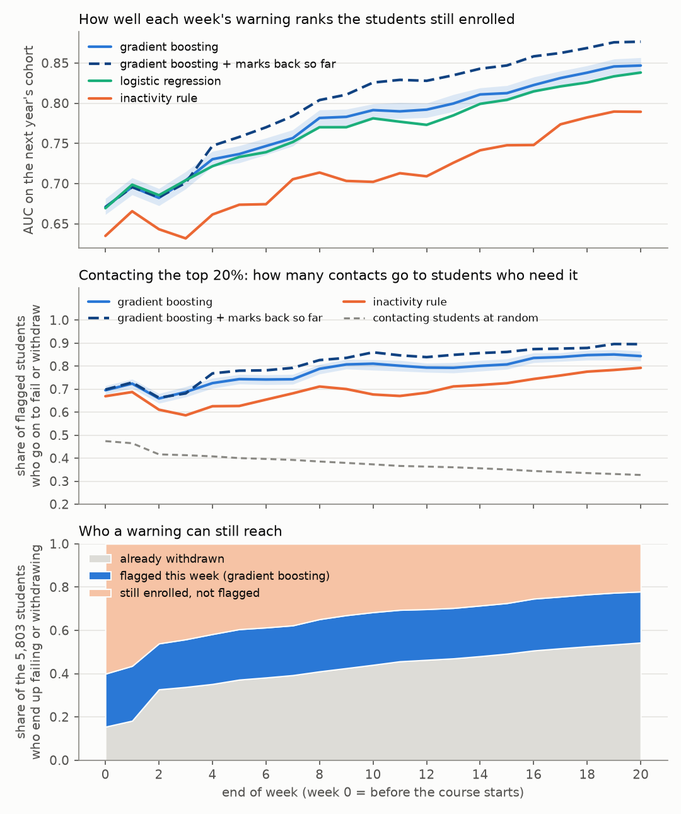
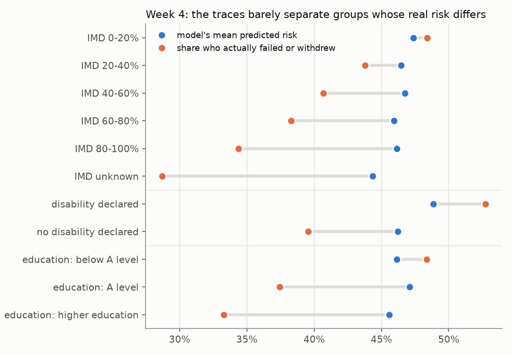
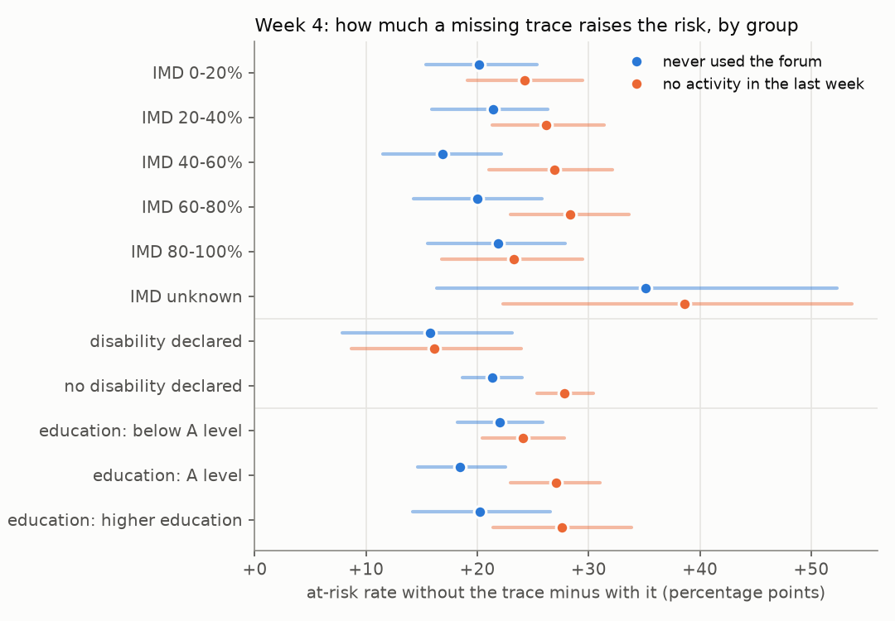

# early-warning-audit

[](https://github.com/shahbanobaber/early-warning-audit/actions/workflows/tests.yml)

Tests an early-warning model built on learning-platform logs as a decision rather than a score. It asks when a warning can still help, who it misses, and whether each trace means the same thing for every student.

**In short**, from 11,260 students in the test year, repeated on a second year:

- **Waiting doesn't help, repeating does.** One round of warnings reaches about a quarter of the students who will fail or withdraw, whichever week it goes out, because later warnings arrive after many have left. Three rounds, at weeks 0, 4 and 8, reach 59%.
- **The missed students look like students who pass.** At week 4, 80% of the future fails it missed had been active the week before, and 1% had missed a deadline. Most were passing their early assignments too, so adding marks catches only about one in eight of them.
- **The scores flatten real differences.** The model misses the same share of at-risk students in every group, but it predicts nearly the same risk for groups whose actual risk differs by as much as 18 points.
- **A missing trace is weaker evidence for students who declared a disability.** They are at higher risk even when every trace looks normal.

## Why

Learning platforms log every click and submission. A common proposal is to read self-regulated learning from those traces, such as time management from when work comes in and help-seeking from forum use, and to warn students who fall behind. Domino and Shaffer (2025) propose judging traces on validity, reliability and equitability. They note that the measures "are approximations, and there is no one truth" to check them against. They also name the null-data problem. A student with no forum trace may have decided the forum wasn't useful, or never thought about it.

An accuracy score can't settle whether a warning system works, so this project puts narrower questions to a deliberately ordinary model.

## Data

The [Open University Learning Analytics Dataset](https://doi.org/10.24432/C5KK69) (Kuzilek et al., 2017, CC BY 4.0) has 32,593 enrolments on 7 online modules, run 22 times between 2013 and 2014. It records daily platform clicks, assessment submissions and final results, plus the deprivation band of each student's home area, declared disability and prior education. It isn't a computing course. It is the public dataset that has both traces and demographics. The CodeWorkout data from the CSEDM challenges has no demographics, so the group questions can't be asked of it.

## How it works

- **Features use only the past.** At the end of each week from 0 to 20 the model sees clicks by activity type, recency and regularity, forum and quiz use, submission timing and registration timing, all dated before that point. No demographics or module identity, and no marks except in one comparison. A test changes everything after the cutoff and checks that no feature moves.
- **Only reachable students count.** Students who have already withdrawn are counted separately, since no warning can reach them.
- **Train on the past, test on the next run.** Train on 2013B to 2014B, test on 2014J (11,260 students, 5,803 of whom fail or withdraw). The repeat trains on 2013 and tests on 2014B.
- **Four rankings.** Gradient boosting, logistic regression as a check, an inactivity rule that needs no model, and gradient boosting plus the marks a tutor would have back by that week.
- **A warning is a contact list.** Each week tutors contact the 20% of enrolled students ranked most at risk. Intervals are 95% bootstrap intervals over students.

## Results

### 1. Waiting for a better warning doesn't reach more students



| End of week | AUC | Precision of the contact list | At-risk students already withdrawn | At-risk students reached |
|---|---|---|---|---|
| 0 (before the start) | 0.67 | 70% | 15% | 25% |
| 4 | 0.73 | 73% | 35% | 23% |
| 8 | 0.78 | 79% | 41% | 24% |
| 20 | 0.85 | 84% | 54% | 24% |

The warning gets more accurate every week, but the students it would catch keep leaving, a third of them by the end of week 2. One round of contacts reaches 21% to 25% of the eventual fails and withdrawals whatever the week, with a budget of 10% or 30% too. The list made before the course starts does as well as the list at week 20. Logistic regression is within 0.02 AUC of boosting every week, and the inactivity rule trails by 0.01 to 0.09.

Repeating works where waiting doesn't. In the table below each round contacts 20% of the students still enrolled, skipping anyone already contacted.

| Rounds at | At-risk students reached | Students contacted | Contacted who were at risk |
|---|---|---|---|
| Week 0 | 25% | 18% of the cohort | 70% |
| Weeks 0 and 4 | 44% | 35% | 66% |
| Weeks 0, 4 and 8 | 59% | 50% | 60% |
| Weeks 0, 4, 8 and 12 | 66% | 66% | 52% |
| Every week to 20 | 79% | 89% | 46% |

The second round finds at-risk students almost as well as the first (62% of its new contacts, against 70%). By the fourth round, three in four new contacts go to students who will be fine.

### 2. The students it misses look like students who pass

| At week 4 | Students | Active in the last week | Median click rank in their course | Missed a deadline |
|---|---|---|---|---|
| Passed | 5,456 | 87% | 60th percentile | 2% |
| At risk and flagged | 1,338 | 42% | 11th | 49% |
| Will fail, not flagged | 1,302 | 80% | 45th | 1% |
| Will withdraw later, not flagged | 1,118 | 86% | 50th | 1% |

The traces pick up disengagement, such as going quiet or missing deadlines. The students the list misses were active, on time and mid-pack for clicks. It catches future fails and future withdrawals at similar rates (34% and 37% at week 4). Since the two models land within 0.02 AUC of each other, the limit is in the traces, not the model.

Adding the marks a tutor would have back helps only a little. By week 8, 86% of students have a mark back. AUC rises from 0.78 to 0.80 and precision from 79% to 83%, but the list then catches only 13% of the future fails the click-only list missed (8% in the second year). Most of those students were passing their early work. By week 8, 13% of them had failed a mark, against 10% of students who go on to pass. Their marks sat lower, around the 35th percentile of their course against the 63rd, but not yet below the pass line.

Marks are ranked within each course run, as clicks are. Raw marks made the warning worse in one module. BBB's first assignment in 2014J counted for nothing and its median mark was 100, against 72 to 74 in earlier years, so a model that had learned what a high mark means was misled.

### 3. The same share is missed in every group, but the scores flatten real differences

At week 4 the list misses 64% of the at-risk students still enrolled, and every group sits within 3 points of that. In the test year no gap is distinguishable from zero at week 4 or week 8. Precision differs (80% for the most deprived fifth of areas, 63% for the least deprived), as it must when base rates differ and miss rates are equal (Kleinberg et al., 2017).



For the most and least deprived fifths of areas the model predicts 47% and 46%, but 48% and 34% actually fail or withdraw. Prior education (46% and 46% predicted, 48% and 33% observed) and disability (49% and 46%, against 53% and 40%) follow the same pattern. As a contact list it works about equally well for everyone. Read as a probability, it is too low for students with a declared disability or without A levels, and about 12 points too high for students from the least deprived areas or with a degree.

### 4. Each trace against the three criteria

This part uses no model. It looks at each absent trace at week 4 across all 22 course runs, 27,535 students still enrolled.

| Trace absent | Skill it stands for | Extra risk, all students | Inside each course run | For students who declared a disability, against everyone else |
|---|---|---|---|---|
| No activity in the last week | regular study | +26 pts | +11 to +54 (22 of 22 runs) | −7 [−12, −3] |
| Missed an assessment deadline | meeting deadlines | +49 pts | +41 to +58 (16 of 16) | −9 [−13, −5] |
| Never used the forum | help-seeking | +23 pts | +9 to +49 (21 of 21) | −7 [−12, −3] |
| Never took a quiz | self-testing | +8 pts | +11 to +60 (18 of 18) | −2 [−6, +2] |
| No activity before the start | planning | +19 pts | +9 to +42 (22 of 22) | −5 [−9, +1] |

- **Predictive.** Every absent trace raises risk. That is only the outcome side of validity. Outcomes can't show that a trace measures the skill it is named after.
- **Stable.** Each trace points the same way in every course run, but its size varies up to fivefold, except for missed deadlines. Pooling can mislead. The quiz trace adds 11 to 60 points inside each run but only 8 pooled, because four lower-risk runs had no quiz activity by week 4.
- **Same meaning.** For students who declared a disability every trace is weaker evidence, because their risk is high even when the trace is present (49% against 37% for a quiet week). Students without A levels show the same pattern, smaller, and students with a degree mostly the opposite. Reading silence as the warning sign underrates the students who start out at higher risk.



In the model's test year (figure above), a quiet week adds 16 points for students who declared a disability and 28 for everyone else.

### 5. Which traces carry the warning

Shuffling one family of traces at week 4 drops AUC by 0.089 for assessment timing and 0.081 for recency and regularity, but only 0.002 for forum and live-tutorial use. Help-seeking is a strong signal on its own (+23 points above) and adds almost nothing once the others are known. AUC ranges from 0.68 to 0.76 across the seven modules.

### The second year

The whole analysis was rerun, training on 2013 only and testing on 2014B (7,804 students).

| | Test year 2014J | Test year 2014B |
|---|---|---|
| Reach of one round of contacts, any week | 21% to 25% | 22% to 25% |
| Missed future fails active the week before (week 4) | 80% | 74% |
| Predicted risk, most and least deprived fifth | 47% and 46% | 51% and 47% |
| Actual risk, most and least deprived fifth | 48% and 34% | 57% and 39% |
| Quiet week, disability declared against others | −12 pts [−20, −4] | −5 pts [−13, +4] |
| Missed deadline, disability declared against others | −10 pts [−18, −2] | −11 pts [−19, −2] |
| At-risk reached by rounds at weeks 0, 4 and 8 | 59% | 57% |
| Missed future fails the marks list catches (week 8) | 13% | 8% |

The first three findings hold. The disability result points the same way for all five traces in both years, and its interval clears zero for a missed deadline in both years and for a quiet week in 2014J only. Two of 22 miss-rate comparisons clear zero, by 5 and 6 points. Module CCC, with no earlier run to learn from, has the lowest AUC (0.64 at week 4). Every table is in [results/summary.md](results/summary.md) and [results/replication-2014B/summary.md](results/replication-2014B/summary.md).

## Run it

```bash
pip install -e ".[dev]"
pytest
python -m ewaudit download                 # OULAD from UCI, about 45 MB
python -m ewaudit run                      # about 6 minutes on one core, under 1 GB of memory
python -m ewaudit run --test 2014B --out results/replication-2014B
```

## Limits

- **Not a computing course, and not anyone's own platform.** This shows a way to evaluate a warning system, not a finding about any particular course.
- **Equity audits of at-risk models are an active area.** What this adds is tying one to the questions about trace validity and null data.
- **Two test years from one university.** Both come from the same seven modules.
- **Many comparisons, uncorrected.** The disability pattern is reported because it shows up across traces, course runs and both years, not because of any one interval.
- **The groups are coarse.** Deprivation is measured for the home area, not the student. Disability is self-declared. Small education categories are merged.
- **Withdrawal mixes reasons.** Some students leave for reasons no tutor contact could change.
- **The 20% budget is an assumption.** The summary also has 10% and 30%.
- **So is the marking lag.** OULAD doesn't record when marks came back, so tutor-marked work counts 14 days after its deadline.
- **Secondary analysis of public, anonymised data.** There was no student contact and no ethics review.

## References

- Domino, M., & Shaffer, C. A. (2025). Using a wider digital ecosystem to improve self-regulated learning. *Frontiers in Education*, 10. https://doi.org/10.3389/feduc.2025.1487344
- Kleinberg, J., Mullainathan, S., & Raghavan, M. (2017). Inherent trade-offs in the fair determination of risk scores. *Innovations in Theoretical Computer Science (ITCS)*.
- Kuzilek, J., Hlosta, M., & Zdrahal, Z. (2017). Open University Learning Analytics dataset. *Scientific Data*, 4, 170171. https://doi.org/10.1038/sdata.2017.171

MIT license.
